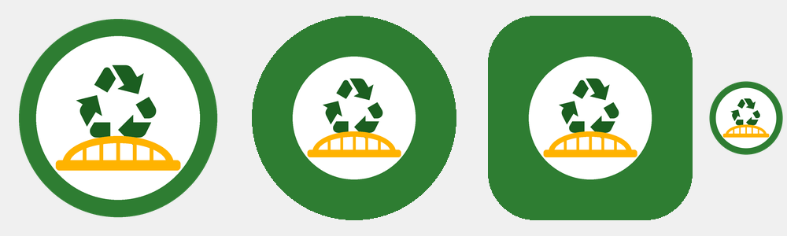
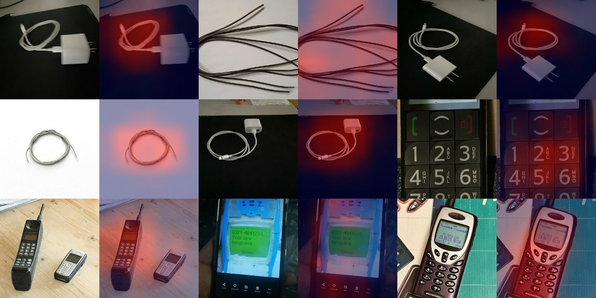

<p align="center">
  
</p>

<h1 align="center">RecySetu ♻️🌉</h1>

<p align="center">
  <b>A bridge between the kabadiwala and the authorised e-waste recycler.</b><br>
  Offline-first · no reading needed · speaks 12 Indian languages · AI on the phone · tamper-proof receipts
</p>

<p align="center">
  Smart India Hackathon 2026 · Problem statement <b>SIH26229</b> · Ministry of Mines (Clean &amp; Green Technology)<br>
  Built by <b>Team ByteStorms</b> ⚡
</p>

---

## Table of contents
1. [The problem](#1-the-problem)
2. [Our solution](#2-our-solution)
3. [What the app does, screen by screen](#3-what-the-app-does-screen-by-screen)
4. [How it works inside](#4-how-it-works-inside)
5. [Tech stack](#5-tech-stack)
6. [Project structure](#6-project-structure)
7. [Run it yourself](#7-run-it-yourself)
8. [Testing](#8-testing)
9. [Data and honesty](#9-data-and-honesty)
10. [Limitations and next steps](#10-limitations-and-next-steps)
11. [More documents](#11-more-documents)

---

## 1. The problem
India generated about **14 lakh tonnes of e-waste** last year, and **90–95%** of it is collected and handled by the informal sector: the *kabadiwala* who comes to your street.

The kabadiwala:
- **often can't read** English (and sometimes not any language),
- has a **cheap Android phone** with **patchy internet**,
- **doesn't know a fair price** for a circuit board, a copper cable or a lithium battery, so he is often underpaid,
- frequently sells to **unauthorised dismantlers** who burn wires and dump battery acid,
- has **no record** of what he sold, to whom, or for how much.

The government (CPCB) keeps a list of **authorised recyclers**, but there is no simple bridge between them and the kabadiwala.

## 2. Our solution
**RecySetu** (*Recy* = recycle, *Setu* = bridge) is an Android app built for exactly this user:

| Design rule | What it means in the app |
|---|---|
| **No reading needed** | Every action is a big picture + 1–2 words + a **spoken** instruction |
| **Works offline** | After the first login, the full sale works with **no internet**; data syncs later by itself |
| **Speaks his language** | **12 languages**: Hindi, Garhwali, Bhojpuri, Marathi, English, Bengali, Punjabi, Urdu (right-to-left), Gujarati, Tamil, Telugu, Kannada |
| **Fair price, out loud** | Weight × published scrap rate = a price range that the phone **says aloud** |
| **Only authorised recyclers** | Real recyclers from the official **CPCB list**, ranked by rate, distance and pickup |
| **Proof of every deal** | A **tamper-evident QR receipt** (SHA-256 fingerprint) that the recycler verifies, even offline |
| **Money first** | The deal is complete only when the kabadiwala taps **"Yes, I got the money"** |
| **Cash = UPI** | Cash is a first-class payment option, not an afterthought |
| **Cheap phones** | Works on Android 7+ and 2 GB RAM phones; release APK ≈ 29–35 MB |

### The core demo (works in airplane mode ✈️)
```
📷 Photo of scrap ─▶ 🤖 AI suggests "Mixed plastic, 92%" ─▶ ⚖️ Type weight (350 g)
      ─▶ 🔊 "You will get about ₹… "  ─▶ 🏭 Pick an authorised recycler
      ─▶ 🔲 QR receipt  ─▶ 📱 Recycler scans: ✅ "Record is genuine"  ─▶ 💵 Cash / UPI
      ─▶ 🌐 Internet returns ─▶ 🔊 "Did you get the money?" ─▶ ✅ Yes ─▶ 📒 Earnings updated
```

## 3. What the app does, screen by screen

### Kabadiwala (seller)
| Screen | What happens |
|---|---|
| **Language** | Tap a language once to hear it, tap again to choose. 3 featured + "More languages" |
| **Login** | Phone number + OTP (Firebase), then a 4-digit **PIN** for daily use |
| **Who are you?** | Kabadiwala or Recycler. Recyclers must be verified (see below) |
| **Home** | 4 big tiles: **Sell scrap · Today's rates · My earnings · Safety**. Voice on/off, language, logout |
| **Photo** | Take 1–3 photos. They are compressed on the phone and uploaded later |
| **What is it?** | The **on-phone AI** looks at the photo. If it is ≥ 70% sure, its pick **pops up big on top** with the % and is spoken; everything else is below |
| **Weight** | Type in **grams or kg** on a big keypad (or +/− buttons). The live price shows on the button |
| **Price** | The app **speaks the price range**, e.g. "about 45 to 55 rupees" |
| **Recyclers** | Authorised recyclers near you (GPS), ranked by **rate (45%) + distance (35%) + pickup (20%)**, with call buttons |
| **QR receipt** | A QR code + short reference like `A3F9-C21B`, spoken letter by letter |
| **Did you get the money?** | After the recycler confirms: big green **Yes** / red **No**. Only "Yes" completes the deal |
| **My earnings** | Today, this week, all entries, spoken summary. "Sold elsewhere" entries can be added too |
| **Safety** | 5 spoken safety cards (batteries, old TVs, burning wires…). Dangerous items show their card first |

### Recycler (buyer)
| Screen | What happens |
|---|---|
| **Apply** | A recycler enters their CPCB/SPCB authorisation number; the team checks it against the official list and approves it with a script |
| **Scan QR** | Scans the kabadiwala's QR **offline** and re-computes the fingerprint: ✅ genuine or ⚠️ changed |
| **Confirm** | Enters the weight they measured (warning if it differs > 10%), pays **Cash or UPI**, confirms |
| **Recent deals** | Each deal shows 🕒 waiting for the kabadiwala, ✅ complete, or ⚠️ "money not received" |
| **My rates** | The recycler updates their own buying rates, which feed the ranking |

## 4. How it works inside

### 4.1 Offline-first sync
All records are written to **Cloud Firestore with offline persistence**. A write is saved **on the phone immediately** and sent to the server when internet returns. The app never waits for the network, and a small **sync icon** shows grey (offline) → amber with a count (sending) → green (all sent).

Every record has an ID created on the phone (a UUID), so sending the same record twice never creates a duplicate.

### 4.2 The tamper-proof QR receipt
```
Phone A (kabadiwala)                         Phone B (recycler)
  deal details + SHA-256 fingerprint ── QR / camera ──▶ re-computes fingerprint
        │                                                   ✅ match = genuine
        │                                                   ⚠️ mismatch = changed
   saved on phone                                   confirmation saved on phone
        │            ── internet returns ──                  │
        └──────────────▶  Firebase  ◀────────────────────────┘
                              │
  Phone A: "Did you get ₹420 cash?" ─▶ Yes ─▶ receipt saved ─▶ deal complete on both phones
```
- The deal is written in a fixed order (`v1|id|collector|recycler|material|grams|paise|time|lat|lng|photos`) and hashed with **SHA-256**. Changing even one gram gives a completely different fingerprint.
- The QR carries the deal **and** its fingerprint, so the recycler's phone can check it **without internet**.
- Saved handovers **cannot be edited** on the server (Firestore security rules).
- Honest limit: a fingerprint proves a record **was not changed**; it is not a legal signature. Per-user digital signatures are a next step.

### 4.3 The three records of a deal
| Collection | Written by | Contains |
|---|---|---|
| `handovers/{id}` | Kabadiwala | The sealed deal + fingerprint (never editable) |
| `confirmations/{id}` | Recycler | Measured weight, amount, Cash/UPI, warning flags |
| `receipts/{id}` | Kabadiwala | "Yes, I got the money" / "Not received" |

A deal is **complete** only when all three exist and the receipt says *received*. Only then does it count in **My earnings**.

### 4.4 The on-phone AI
- **Model:** MobileNetV2 (pre-trained on ImageNet) with a new 9-class head, trained by us with **transfer learning**, then converted to **int8 TensorFlow Lite** (2.7 MB).
- **Classes:** PCB, copper cable, lithium battery, lead battery, old TV (CRT), motor, mixed plastic, phone, and **OTHER** (not scrap).
- **Training data:** ~690 photos (mostly Wikimedia Commons with credits in `data/photos/CREDITS.csv`, plus our own), hand-checked, with zoom/flip/brightness augmentation.
- **Accuracy: 80% on 137 photos it never saw** (see [`analysis/classifier_report.md`](analysis/classifier_report.md)).
- **Heat maps** (Grad-CAM) show it looks at the object, not the background:

<p align="center"></p>

- It only **suggests** (when ≥ 70% sure); the kabadiwala always makes the final tap.

### 4.5 Voice
- Every screen speaks its instruction; every tile says its name when tapped. **Back** stops speech, and there is a **voice off** switch.
- Numbers are spoken the Indian way (lakh / thousand / hundred).
- Uses Android's offline text-to-speech, falling back to Hindi when a language has no voice; Garhwali and Bhojpuri are set up for recorded clips.

### 4.6 Money and weight are never decimals
Weight is stored in **grams (int)** and money in **paise (int)**, so there are no rounding errors (`₹45.50` is `4550`). All times are stored in **UTC** and shown in local time.

## 5. Tech stack
| Part | Choice |
|---|---|
| App | **Flutter** (Dart), Android only, minSdk 24 |
| State | **Riverpod 3** |
| Login | **Firebase Phone Auth** (OTP) + local PIN |
| Database | **Cloud Firestore** with offline persistence, protected by [`firestore.rules`](firestore.rules) |
| Plan | Firebase **free Spark plan** only (photo thumbnails stored as small base64 docs, no Cloud Storage) |
| AI | **TensorFlow Lite** (`tflite_flutter`), model trained in Python with TensorFlow |
| Voice | `flutter_tts`, `just_audio` |
| QR | `qr_flutter` (show), `mobile_scanner` (scan, works offline) |
| Location | `geolocator` |
| Hashing | `crypto` (SHA-256) |
| Scripts | Python: seed data, recycler approval, photo collection, AI training |

## 6. Project structure
```
.
├── app/                     Flutter app
│   ├── lib/
│   │   ├── core/            Plain-Dart logic + shared widgets (all unit-tested)
│   │   │   ├── audio/       Speech planner, number-to-speech
│   │   │   ├── geo/         Location, distance, recycler ranking
│   │   │   ├── hash/        SHA-256 handover fingerprint, warning flags
│   │   │   ├── i18n/        12 languages
│   │   │   ├── ledger/      Earnings totals, deal status
│   │   │   ├── sync/        Sync icon, photo queue
│   │   │   ├── valuation/   Price range, price trend
│   │   │   ├── vision/      On-phone scrap classifier
│   │   │   └── widgets/     Big talking building blocks (tiles, buttons, keypad, logo)
│   │   ├── data/            Models, Firestore repositories, providers
│   │   └── features/        One folder per screen group
│   │       ├── onboarding/  Language, login, PIN, role, recycler apply, splash
│   │       ├── home/        Collector home
│   │       ├── sell_lot/    Photo → category → weight → price
│   │       ├── recyclers/   Ranked authorised recyclers
│   │       ├── handover/    QR receipt, "did you get the money?"
│   │       ├── recycler_mode/ Scan, verify, confirm, recent deals, my rates
│   │       ├── ledger/      My earnings
│   │       ├── prices/      Today's rates board
│   │       ├── safety/      Safety cards
│   │       └── debug/       Hidden demo tools
│   ├── assets/
│   │   ├── i18n/            <lang>.json: every word the user sees
│   │   ├── models/          model.tflite + labels.txt
│   │   └── seed/            Offline copy of materials, prices, recyclers
│   └── test/                Unit + widget tests
├── data/                    Field-study CSVs: materials, prices, recyclers, areas
├── scripts/                 Python helpers (seed Firestore, approve recyclers, train AI)
├── analysis/                AI accuracy report + heat maps
├── docs/                    Plan, setup, demo script, full project record (PDF)
└── firestore.rules          Who can read/write what
```
The rule we followed: **screens only show things**; all calculations live in `app/lib/core/` as plain Dart classes with tests.

## 7. Run it yourself

### Option A: just install the app
Ask the team for the signed APK (`RecySetu-most-phones.apk` for most phones, `RecySetu-old-phones.apk` for very old 32-bit phones), open it on an Android 7+ phone and tap **Install** (allow "install unknown apps" if asked).

### Option B: build from source
Full step-by-step instructions are in **[docs/SETUP.md](docs/SETUP.md)**. In short:
```bash
# 1. Tools: Flutter (stable), Java 17, Android SDK 36, Firebase CLI, Python 3
# 2. Get the packages and check everything
cd app
flutter pub get
flutter analyze
flutter test

# 3. Run on a phone with USB debugging on
flutter run

# 4. Release build (signed if app/android/key.properties exists)
flutter build apk --release --split-per-abi --obfuscate --split-debug-info=build/debug-symbols
```

Firebase setup (only needed for a new Firebase project):
```bash
firebase deploy --only firestore:rules
python3 -m venv .venv && .venv/bin/pip install -r scripts/requirements.txt
.venv/bin/python scripts/seed_firestore.py        # needs scripts/serviceAccount.json (never committed)
```

### Demo logins
The Firebase project has **test phone numbers** (no SMS is sent; the code is fixed). Ask the team for the numbers and code, and see [docs/demo-script.md](docs/demo-script.md) for the two-phone demo.

### Recycler approval
```bash
.venv/bin/python scripts/approve_recycler.py                  # list pending applications
.venv/bin/python scripts/approve_recycler.py --approve <UID> --recycler <recycler_id>
```

## 8. Testing
```bash
cd app && flutter test
```
**145 automated tests** cover price maths, recycler ranking, SHA-256 receipts, number-to-speech, the earnings ledger, the payment-received rule, the AI's 70% rule, all 12 language files, and the main screens at a small phone size **and** the largest font size.

`flutter analyze` reports no issues.

## 9. Data and honesty
- **Prices** come from published scrap-rate listings; every price row keeps its source.
- **Recyclers** are the real authorised e-waste recyclers for Uttarakhand from the official **CPCB list**. Their phone numbers and rates are not public, so the app shows **"Rate not known"** instead of guessing.
- Anything not real is **clearly marked**: the demo recyclers are named *"DEMO Recycler (test account - not real)"* and *"TEST Recycler (fake - for testing only)"*, and placeholder rows carry `"placeholder": true`.
- We never invent business names or phone numbers.
- Regional context and sources: [`data/regional_facts.md`](data/regional_facts.md).

## 10. Limitations and next steps
| Now | Next |
|---|---|
| AI trained on ~690 photos (80%) | More real photos from kabadiwalas → better accuracy, especially motors and lead batteries |
| Fingerprint proves "not changed" | Per-user digital signatures for legal-grade proof |
| Garhwali/Bhojpuri text is a draft | Field-study review + recorded voice clips |
| Recyclers approved with a script | Admin screen inside the app |
| APK shared directly | Google Play Store listing + in-app updates |
| Prices from listings | Recyclers keep their own live rates in the app |

## 11. More documents
| File | What's inside |
|---|---|
| [docs/RecySetu-Project-Record.pdf](docs/RecySetu-Project-Record.pdf) | The full story of the build in simple language (19 pages) |
| [docs/PLAN.md](docs/PLAN.md) | The original phase-by-phase build plan |
| [docs/SETUP.md](docs/SETUP.md) | Developer setup on a Mac, signing keys, releases |
| [docs/demo-script.md](docs/demo-script.md) | The 3-minute two-phone demo for judges |
| [docs/offline-test.md](docs/offline-test.md) | How we test the offline flow |
| [analysis/classifier_report.md](analysis/classifier_report.md) | AI accuracy per class + confusion matrix |

---

<p align="center">
  Made with ♻️ for India's kabadiwalas by <b>Team ByteStorms</b> · SIH 2026<br>
  <sub>Formerly "Kabadiwala Connect". The Android package ID keeps the old name so existing installs and Firebase keep working.</sub>
</p>
